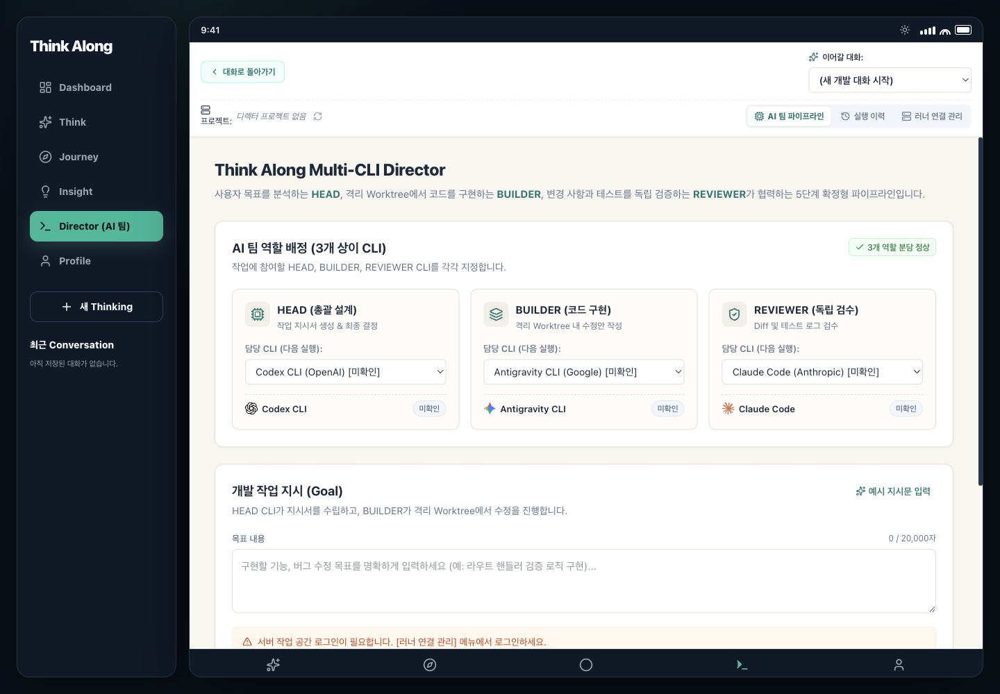

# Think Along 통합 — 2026-11-17

기존 Think Along의 대화·Journey·Insight·Profile 안에 AI 개발 화면을 통합했다. `/projects`는 기존 제품을 열고, `/projects?view=director`는 같은 탐색 구조에서 개발 화면을 연다. 별도 화면으로 연결하던 구조를 공유 컴포넌트 `components/think/ThinkAlong.tsx`로 바꿨다. 기존 `/legacy`, Studio 체험과 명시적 로컬/클라우드 프로젝트 경로는 유지한다.

## 연결된 동작

- 이어갈 대화를 선택하면 서버가 소유권·전달 권한을 검사하고 기존 Context Engine으로 최근 원문·확정 결정·활성 방식을 조립한다. 모든 CLI 역할이 같은 `thinkalong_session_id`와 패킷을 받는다. 클라이언트가 넣은 임의 Context는 제거한다.
- 새 개발 목표는 AI API 호출 없이 새 Thinking으로 기록한다. 요청·단계별 검증/검수 결과·실패·공유 diff는 같은 대화에 중복 없이 기록한다. 사용자 결정이나 기존 모델 선택은 자동 변경하지 않는다.
- 원격 비밀번호 로그인은 기존 대화 세션도 발급한다. 원격 기기·Origin·소유권·실행 권한 검사는 유지하며 간이 이메일 쿠키만으로 원격 작업을 시작할 수 없다. 두 로그아웃 경로가 쿠키를 지우고 서버 토큰을 폐기한다.
- 대화와 원격 작업의 계정이 다른 쿠키 조합은 문맥을 읽기 전에 차단한다. 격리 프로덕션 HTTP 검사에서 수정 전 누락을 재현하고 수정 후 403 차단을 확인했다.
- 공유 Alex 계정으로 자동 가입/로그인하던 진입·대화 시작 경로를 제거했다. 로그인은 기존 연결 컴포넌트를 재사용한다.
- Next.js 빌드에서 실제 보안 알림이 발생해 Next.js와 해당 런타임 패키지만 16.4.3 → 16.4.6으로 갱신했다. 근거: [공식 보안 권고 GHSA-mfr8-8qww-v76h](https://github.com/vercel/next.js/security/advisories/GHSA-mfr8-8qww-v76h). 운영 의존성 감사 결과는 취약점 0건이다. 개발 의존성의 기존 moderate 항목은 이번 통합에서 일괄 갱신하지 않았다.

## 검증

| 확인 | 결과 |
|---|---|
| `npm run verify` | lint·typecheck·test·production build 성공. 47개 중 46 pass, 0 fail, 기존 opt-in 1 skip |
| 실제 Git·npm과 로컬 daemon HTTP 통합 | 3개 역할에 같은 canonical 대화와 결정 전달, 원본 불변, 실제 verifier, 취소·재시작·중복 방지 통과. 추론 응답은 명시적 fixture |
| `node tests/director-continuity-http.mjs http://127.0.0.1:3187` | 격리된 프로덕션 서버에서 두 쿠키, 대화 생성/이어가기, 결정 전달, 실패·성공 결과, 소유권·정책 차단, 양쪽 로그아웃과 이전 토큰 폐기 통과 |
| `node tests/director-browser.mjs http://127.0.0.1:3187` | Orca 인앱 브라우저에서 1440/900/390px, 실제 HTTP enqueue/cancel/실패, 대화 복귀·재진입, 이력, 권한, 로그아웃, 폼 대비 통과 |
| `node tests/studio-browser.mjs http://127.0.0.1:3187` | 기존 Studio의 세 화면 크기 회귀 검사 통과 |
| 추가 변경한 브라우저 검사 스크립트 | ESLint·diff 검사 통과 |

운영 스크린샷 검수에서 임베디드 제어 영역과 본문이 나란히 배치되는 문제를 발견했다. 임베디드 컨테이너의 flex 방향을 세로로 지정하고 세 화면 크기에서 제어 영역이 본문 위에 오는지 회귀 검사에 추가했다. 수정 후 전체 verify와 브라우저 동작 검사를 다시 통과했다.

프로덕션 HTTP와 브라우저 fixture는 `/tmp/thinkalong-integrated-app.fxiqKo`의 별도 DB를 사용했다. 운영 사용자 데이터로 가입·실행·삭제 테스트를 하지 않았다. 주 작업자의 전체 검증 로그는 `/tmp/thinkalong-fusion-verify-20261117.log`다. 임시 로그의 영구 보존은 보장하지 않는다.

## 교차 검수와 한계

Orca Run `run_471ee13821e7`, Task `task_61df74313b14`, Dispatch `ctx_543c019c226d`. agy는 Paseo 터미널에서 실행해 UI를 맡았고 서버·CLI 변경을 읽기 전용 검수했다. 주 작업자는 UI diff를 교차 검수하고 실제 프로덕션 HTTP·브라우저·최종 전체 검증을 직접 실행했다. 협업 기록용 Orca 셸에서 agy를 실행하지 않았다.

실제 로컬 Claude CLI의 `auth status`는 `loggedIn: false`였다. 실계정 3개 CLI 전체 완주는 검증하지 못했다. 구현 검증은 실제 Git·npm·HTTP·daemon과 명시적 추론 fixture를 구분한다. 운영 실행은 로그인된 로컬 CLI 러너를 필요로 하며 개인 인증을 서버로 옮기거나 자동 fallback하지 않는다. 원본 자동 반영과 자동 배포 기능은 추가하지 않았다.

원본 `think-along`, 참조 `ai-dev-director`, 사용자 미추적 `thinkalong-studio/`는 수정하지 않았다.

## 최종 배포 증거

- 운영 URL: https://thinkalong.ai.kr/projects. 개발 화면: https://thinkalong.ai.kr/projects?view=director.
- 최종 코드 SHA: `45e4ea9ca834c7f07c5271d8748bf338679e7a4b`.
- [GitHub Actions 43998453091](https://github.com/ryujish/think-along/actions/runs/43998453091): `success`. CI에서도 `npm ci`, 전체 verify, 릴리스 업로드·활성화·공개 revision 검사가 성공했다. 테스트 47개 중 46 pass, 0 fail, 기존 opt-in 1 skip.
- `/release.txt`가 최종 SHA와 정확히 일치했다. `/projects`, `?view=director`, `?view=studio`, `?source=cloud`, `/legacy`는 모두 HTTP 200. 인증 없는 대화·Provider·remote 요청은 HTTP 401이다.
- 최종 운영 화면에서 1440/900/390px 모두 기존 탐색 구조, 역할 3개, main 영역 1개, 제어 영역의 상단 배치와 가로 넘침 없음을 확인했다. 해당 탭의 콘솔 항목은 빈 목록이었다. 운영 기본 화면을 Orca 새 탭으로 열었다.
- 배포는 기존 Actions 워크플로만 사용했다. 활성화 로그의 `database preserved`를 확인했다. 배포 로그: `/tmp/thinkalong-fusion-deployment-43998453091.log`.
- 기능 브랜치 `codex/director-cli-workspace-2026-11-16`에서 명시적으로 배포했다. main 병합은 수행하지 않았다. 이후 main으로 배포할 때 이 변경을 포함해야 한다. 이 결과 기록과 스크린샷은 코드 배포 후 문서 커밋으로 별도 보존한다.

